### Hello! I'm Deepika 👋

B.E. Computer Science and Engineering student - Data science at **AMC Engineering College**.

I enjoy building practical web applications, improving my programming skills, and solving problems through technology.

---

## About Me

- 🎓 Pursuing **B.E. in Computer Science and Engineering — Data Science** at AMC Engineering College.
- 💻 Interested in **full-stack web development**, data science, and problem solving.
- 🌱 Currently strengthening my skills in Java, Python, C, HTML, CSS, and JavaScript.
- 🚀 Interested in learning through internships and hands-on software projects.

## Experience

**Full Stack Developer Intern — SWYNEX Technologies**  
*Remote | Oct–Nov 2026*

- Worked on project architecture, backend and frontend development, API integration, and deployment tasks as part of the internship workflow.

## Featured Projects

### Queue-less College Canteen Management System
*SFull-stack web application*

- Worked on internship tasks involving project architecture and application development
- Worked on backend development and frontend integration
- Gained practical exposure to connecting frontend interfaces with backend APIs
- Worked towards building a complete deployed application

## Technical Skills

| Category | Skills |
|---|---|
| Programming | Java · Python · C |
| Web Development | HTML · CSS · JavaScript |
| Tools | Git · GitHub · Visual Studio Code |
| Interests | Full-stack development · Data science · Problem solving |

## Certifications

- Introduction to Java
- Internet of Things
- Basic Computer
- Exploring Computers
- EY-Microsoft AI Skills Passport
- GenAI Powdered Data Analytics Job Simulation by Forage

## Education

- **AMC Engineering College** — B.E. Computer Science and Engineering (Data Science), expected 2029 · Current CGPA: 9.1/10
- **Loyola Composite PU College** — Pre-University Course, 2025 · 92.8%
- **St. Philomena English School** — SSLC, 2023 · 77.8%

## GitHub Activity

Your contribution history is available directly on the [GitHub contributions page](https://github.com/deepikat0911). This profile intentionally does not display invented contribution counts, streaks, language percentages, or rankings.

## Connect With Me

- **GitHub:** [@Deepikat-rgb](https://github.com/deepikat0911)
- **LinkedIn:** [Deepika T](https://www.linkedin.com/in/deepika-t-283439381/)

